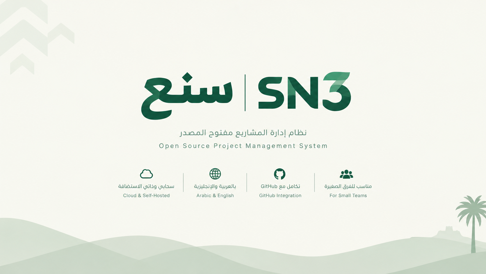

<p align="center">
  
</p>

**Free, open-source project management for modern teams.**

سنع منصة لإدارة الفرق والمشاريع والمهام، بواجهة عربية وإنجليزية، ويمكن تشغيلها سحابيًا أو استضافتها ذاتيًا.

> **Status:** R0 — Foundation complete: accounts (sign-up, sign-in, verification, password reset), teams and tenant isolation, the Arabic/English design foundation, background jobs and Docker Compose self-hosting. Product features (projects, tasks, boards) arrive with R1.

## Planned features
- Teams, invitations, and role-based access
- Public-to-team and private projects with strict access controls
- Tasks, subtasks, workflows, Kanban, list, and calendar views
- Optional sprints, custom fields, templates, and saved views
- GitHub App integration (v1.0); optional GitHub Issues sync (v1.1)
- Arabic RTL / English LTR; light and dark themes

## Technology
Laravel 12 · PHP 8.3+ · Vue 3 · TypeScript · Inertia 2 · PostgreSQL 16+ · Docker Compose

Exact versions are in `composer.lock` and `package-lock.json`, and are recorded in [ADR-011](docs/adr/ADR-011-pinned-toolchain-versions.md).

## Self-hosting
Run SN3 with Docker Compose (app, queue worker, scheduler + PostgreSQL, optional HTTPS proxy): see [docs/SELF_HOSTING.md](docs/SELF_HOSTING.md).

## Local development
Requirements: PHP 8.3+ (extensions `pdo_pgsql`, `mbstring`, `intl`), Composer 2, Node.js 22 LTS, PostgreSQL 16+. No proprietary or paid service is required. Redis is optional.

```bash
composer install
npm ci
cp .env.example .env              # Windows: copy .env.example .env
php artisan key:generate
# Create the PostgreSQL role/database named in .env (defaults: user sn3, database sn3).
php artisan migrate
npm run build                     # or `npm run dev` during development
php artisan serve
```

`composer dev` runs the web server, queue worker and Vite together.

The build tooling lives in `devDependencies`. If `NODE_ENV=production` is set in your shell or system environment, npm skips those packages: use `npm ci --include=dev`.

| Check | Command |
| --- | --- |
| PHP tests (Pest) | `composer test` (uses the `sn3_testing` database from `phpunit.xml` once tests touch the DB) |
| PHP style (Pint) | `composer lint` · fix with `composer format` |
| TS/Vue lint (ESLint) | `npm run lint` |
| TS/Vue format (Prettier) | `npm run format:check` · fix with `npm run format` |
| Type check (vue-tsc) | `npm run typecheck` |
| Production build | `npm run build` |
| PHP static analysis (Larastan, PHPStan level 9) | `composer analyse` |
| Frontend tests (Vitest) | `npm run test` |
| End-to-end (Playwright, seeded tenants) | `npm run e2e` (see [docs/TESTING.md](docs/TESTING.md); resets the `sn3_e2e` database) |
| Dependency advisories | `composer audit --locked` · `npm audit --omit=dev --audit-level=high` |

CI runs all of these on every pull request to `dev` and `main`, together with migrations up/down/up and a Docker image smoke test. A pull request can only merge when every check is green: see [ADR-013](docs/adr/ADR-013-continuous-integration.md).

### UI, localization and theme
- Design tokens follow `docs/DESIGN_SYSTEM.md` and live in `resources/css/tokens.css`. Use the semantic Tailwind classes (`bg-surface`, `text-text-muted`, `rounded-control`, `text-body`, …). The default Tailwind palette is turned off.
- Use logical utilities only (`ms-`/`me-`/`ps-`/`pe-`/`start-`/`end-`/`text-start`), so layouts mirror in Arabic.
- UI strings live in `resources/js/i18n/locales/{en,ar}/<namespace>.ts` and are read with `useI18n().t('namespace.key')`. A missing Arabic key fails `npm run typecheck`. Server-side strings live in `lang/{en,ar}`.
- Fonts (Space Grotesk, IBM Plex Sans Arabic) are bundled from npm. Pages make no third-party font or CDN requests.

Details and rationale: [ADR-014](docs/adr/ADR-014-design-foundation-i18n-theme.md).

## Roadmap
| Phase | Scope |
| --- | --- |
| R0 | Foundation |
| R1 | Core team and project management |
| R2 | Customization and sprints |
| R3 | GitHub App integration and public v1.0 |
| R4 | GitHub Issues sync and v1.1 |

Follow progress through [Issues](../../issues) and the repository's linked GitHub Project when configured. No release dates are committed yet.

## Documentation
Read [`AGENTS.md`](AGENTS.md) for AI contributor instructions, and [`docs/DEVELOPMENT_PLAN.md`](docs/DEVELOPMENT_PLAN.md) for planned tasks. Full requirements, architecture, database, API, and design documents live in `docs/`.

## Contributing
See [CONTRIBUTING.md](CONTRIBUTING.md). Please don't start unassigned implementation work. Security concerns: [SECURITY.md](SECURITY.md).

## License
Licensed under **GNU Affero General Public License v3.0 only (AGPL-3.0-only)**. See [LICENSE](LICENSE).
