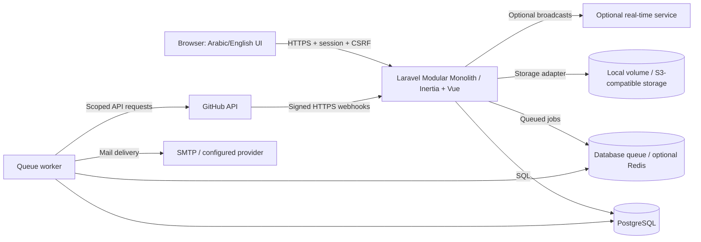
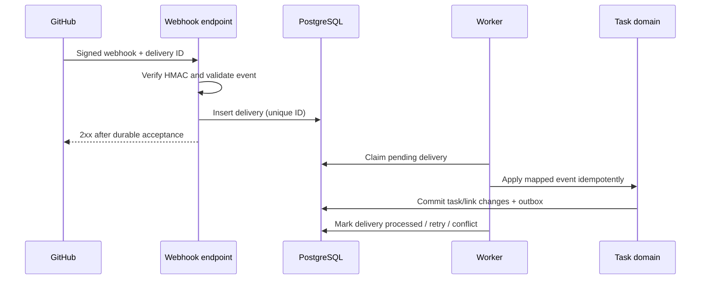

# Software Architecture Document (SAD)

> **Product:** Free, open-source project management for small teams  
> **Document ID:** SAD-PM-001  
> **Version:** 1.0.0 — FINAL, implementation-ready
> **Date:** 2026-10-12  
> **Source of truth:** `BRD.md` (BRD-PM-001 v1.0.0)  
> **Audience:** AI agents, software architects, backend/frontend engineers, QA, DevOps, maintainers

## 0. AI Agent Operating Contract

1. This is the **final technical baseline**, authorized for implementation. The BRD's **CONFIRMED** decisions outrank all architectural recommendations here.
2. Preserve BRD identifiers (`DEC-*`, `FR-*`, `NFR-*`, `OPEN-*`) in code issues, ADRs, tests, and implementation plans. All previously open decisions are closed in the final decision register.
3. Use **MUST / SHOULD / MAY** deliberately. Distinguish **P0** launch requirements from **P1** committed later capabilities.
4. Implement migrations and APIs using the final binding decisions in §16.
5. Treat tenant isolation, private-project secrecy, and webhook trust boundaries as invariants. A green happy-path test is not sufficient.
6. Prefer small, testable vertical slices; avoid speculative abstraction, microservices, unnecessary dependencies, and premature optimization.
7. All UI must support Arabic RTL and English LTR, including forms, boards, keyboard flows, errors, emails, and mobile views.
8. Maintain a **single product codebase** for Cloud and Self-Hosted. Environment-specific operations are configuration, not premium feature forks.
9. When a conflict or ambiguity is found, create an ADR/question and stop only the affected workstream; apply the final decision register.

## 1. Architecture Goals and Constraints

### 1.1 Product invariants — CONFIRMED

- `DEC-001`–`DEC-004`: Completely free; open source; Cloud and Self-Hosted; feature parity.
- `DEC-005`–`DEC-006`: Arabic/English, RTL/LTR, fully responsive web.
- `DEC-007`–`DEC-008`: Multi-team users; fixed Team roles Owner, Admin, Member, Viewer.
- `DEC-009`–`DEC-011`: Unified Task; optional per-project sprints; project-specific workflows, fields, views, templates.
- `DEC-012`: GitHub App integration and optional two-way Issues sync with automation.
- `DEC-013`: Public signup, email/link invitations.
- `DEC-014`–`DEC-017`: Team-visible and private projects; Team Owner has private-project access; Admin does not implicitly have private-project content access; new projects default to team-visible.

### 1.2 Quality attributes

1. **Security:** explicit server-side authorization for every resource and every async operation (`NFR-SEC-001`–`006`).
2. **Operability:** simple documented Docker Compose deployment, upgrades, backups and recovery (`NFR-OPS-001`–`005`).
3. **Usability:** quick task creation, low configuration burden, keyboard/touch accessibility (`NFR-UX-001`–`002`).
4. **Performance:** indexed, paginated queries; avoid N+1 and whole-board loads (`NFR-PERF-001`–`002`).
5. **Resilience:** local task operations must work if GitHub, email, or real-time delivery is unavailable (`FR-GH-011`).
6. **Extensibility:** modular boundaries and integration ports, without a plugin marketplace.

**Operational targets:** attachment quotas, retention and licensing are fixed in §16. No public availability SLA or release date is promised; these are operational measurements, not product-choice blockers.

## 2. Architecture Decisions — APPROVED

| ADR | Choice | Rationale | Alternative / tradeoff |
|---|---|---|---|
| ADR-001 | **Modular Monolith** in Laravel | One deployable, easy local debugging, low operational cost | Microservices increase ops and distributed consistency burden |
| ADR-002 | **Laravel + Inertia.js + Vue 3 + TypeScript** | Integrated authentication, SSR not required initially, fast full-stack delivery | Separate SPA/API is more decoupled but doubles surface area |
| ADR-003 | **PostgreSQL as the only supported production DB initially** | Strong relational integrity, JSONB where appropriate, predictable tests | MySQL support adds compatibility and maintenance work |
| ADR-004 | **Shared-schema team-scoped tenancy** | Low-cost cloud and parity with multi-team self-hosted | DB-per-tenant is operationally expensive; requires strong isolation discipline |
| ADR-005 | **Laravel sessions + CSRF for first-party Inertia UI** | Secure browser flow, no browser-stored bearer token | Sanctum personal access tokens only if/when external API is needed |
| ADR-006 | **Database queue as minimal supported mode** | No mandatory Redis for self-hosted installs | Redis optional for larger installations; workers still required for background work |
| ADR-007 | **Transactional outbox for critical external effects** | Prevent losing notifications/integration actions after DB commit | Adds outbox table and worker complexity |
| ADR-008 | **GitHub App + verified webhooks + queue-based sync** | Scoped permissions and retryable integration | OAuth-only/PAT approaches are less suitable for repo automation |
| ADR-009 | **Object storage abstraction (Laravel Storage)** | Local disk for simple installs; S3-compatible for Cloud | Local volumes need backup and access controls |
| ADR-010 | **Progressive enhancement for live updates** | Core works without WebSockets | Polling/refresh may be less immediate; optional Reverb later |

**Versions:** pin tested, mutually compatible stable releases at implementation kickoff; do not assume future major-version compatibility. Record actual versions in `composer.lock`, `package-lock.json`, deployment images and an ADR.

## 3. System Context and Trust Boundaries



**Boundaries:** browser input is untrusted; every team/project identifier is untrusted; GitHub webhooks are untrusted until signature verification; external GitHub data is untrusted and must be escaped/sanitized; queued jobs must revalidate authorization/context and installation state. Do not expose provider tokens, webhook secrets, signed attachment URLs, or internal stack traces.

## 4. Runtime and Repository Layout

**One Laravel application** serves Inertia pages and versioned integration endpoints. Vue assets are built and served with the application; avoid a separate frontend server in production.

Suggested repository:

```text
app/
  Domain/
    Identity/
    Teams/
    Projects/
    Tasks/
    Workflows/
    Collaboration/
    Sprints/            # P1, optional per project
    Customization/      # P1 extended capabilities
    Integrations/GitHub/# P1
  Http/Controllers/
  Http/Requests/
  Policies/
  Jobs/
  Events/
  Support/Tenancy/
resources/js/
  Pages/
  Components/
  Layouts/
  Composables/
  i18n/
routes/
  web.php
  api.php             # only as required
  webhooks.php        # integration-specific routes
  console.php
 database/migrations/
 tests/Feature/
 tests/Unit/
 tests/Architecture/
 deploy/docker/
 docs/adr/
```

**Boundary rule:** domain modules expose explicit services/actions and DTOs, not cross-module controller calls. Avoid introducing a complex module loader or multiple Laravel apps. Controllers are thin; domain mutations live in transactional application actions; policies centralize authorization; jobs orchestrate retryable external work. UI components must not be the sole enforcers of permissions.

## 5. Tenancy, Authorization, and Project Privacy

### 5.1 Scope model

- `User` is global to a deployment; membership is `(team_id, user_id, role)`.
- Every `Project` has exactly one `team_id`; every `Task` belongs to exactly one `project_id` and inherits its team boundary.
- For performance and consistency, child records may carry `team_id` redundantly **only if** cross-team mismatches are prevented with composite keys, constraints and application validation. Do not trust client-supplied team IDs.
- A user may switch active team; active-team selection is a **UI context**, not authorization.
- A Self-Hosted instance may contain multiple teams. Do not assume instance admin = Team Owner or unrestricted content reader.

### 5.2 Access decision order (deny by default)

1. Authenticated user or explicitly allowed public endpoint?
2. Is the user an active member of the requested team?
3. Is the resource in that team? Resolve parentage from the DB, not request body.
4. For a private project, is the user Team Owner or an explicit authorized project member?
5. Does the Team role plus applicable project-level permission allow the action?
6. Are resource-state rules met (archived, deleted, locked, sprint closed, etc.)?

For Team-visible projects, team members may read content according to role. For Private projects, Team Admin **must not** gain read access merely by being Admin. **DECIDED-003:** project role and Admin metadata behavior are finalized in §16.

### 5.3 Required isolation controls

- Scope list, detail, search, counts, exports, notifications, activity, attachment downloads, and GitHub-linked data by authorization.
- Authorize both before queuing and when executing delayed jobs where applicable.
- Use opaque or authorization-checked attachment routes; never expose private files via public disk.
- Avoid returning `403` versus `404` differences that unnecessarily reveal private project existence; adopt consistent resource-not-found behavior for unauthorized discovery paths.
- Add automated cross-team and private-project negative tests for each resource type, including background processing and bulk actions.
- PostgreSQL RLS is **optional defense in depth**, not the only access control. If added, verify connection pooling and per-request tenant context carefully.

## 6. Core Domain Modules and Contracts

| Module | Owns | Key invariants | BRD |
|---|---|---|---|
| Identity | users, sessions, verification, locale | Verified identity for protected actions | §6.1 |
| Teams | teams, memberships, invitations | One owner policy and transfer rules to be specified | §6.2, §7 |
| Projects | project lifecycle, visibility, members | Exactly one owning team; private membership enforced | §6.3 |
| Tasks | tasks, task keys, assignment, labels, due dates | Stable project-scoped key; valid assignee | §6.4 |
| Workflows | project statuses, transitions, board ordering | No orphaned tasks on status removal | §6.5 |
| Collaboration | comments, audit, notifications, attachments | No visibility bypass through side channels | §6.7 |
| Sprints (P1) | backlog, sprints, membership/history | Optional per project; consistent close behavior | §6.6 |
| Customization (P1) | field definitions/values, views, templates | Project-specific schema validation | §6.5 |
| GitHub (P1) | installations, repo links, mappings, sync jobs | Verified events; idempotency; explicit conflicts | §6.8 |

### 6.1 Task identity and state

- Use immutable internal UUID/ULID or database PK plus a **stable human-readable key** (`PROJECTKEY-123`), unique within its scope. Define key generation atomically under concurrency.
- One unified task model. Labels and custom fields provide flexible classification; do not require Bug/Story/Epic entities.
- Define status ordering per project and valid transitions. Drag/drop is an interface to an authorized transition action.
- **DECIDED-006:** one nullable primary assignee per task; see §16.
- Soft deletion, archive, status migration, and recovery behavior require **DECIDED-011** resolution.

### 6.2 Sprints and customization

- Project `sprints_enabled` controls display and operations; disabling must not silently destroy sprint history.
- Custom field definitions are scoped to projects, with typed validation and migration-safe changes; JSONB may hold typed values only with clear indexing/query strategy.
- Templates initialize project configuration; applying a template must not silently overwrite active project data.
- All configurable fields and workflow statuses must be localizable or support language-neutral identifiers with translated display names.

## 7. Data and Transaction Architecture

- PostgreSQL is authoritative for users, memberships, tasks, workflows, and sync state.
- Use foreign keys, unique constraints, indexes and transaction boundaries, not just model validation.
- Required index candidates: memberships `(team_id,user_id)`, projects `(team_id,visibility)`, tasks `(project_id,status_id,sort_order)`, tasks `(project_id,assignee_id)`, tasks `(project_id,task_number)`, GitHub deliveries `(installation_id,delivery_id)` unique, issue mappings `(installation_id,repository_id,issue_number)` unique.
- Task creation and sequence assignment are one atomic operation. Status transitions and activity records are one transaction.
- Store timestamps in UTC; present in user timezone and locale. Define timestamp semantics for due **dates** separately from due **times**.
- Use an **outbox** for events that must be delivered after committed mutations; consumer processing is at-least-once, therefore handlers must be idempotent.
- Define migration/backfill rules before adding mandatory columns to existing production tables. Avoid destructive schema changes without a recovery plan.
- Retention, hard deletion, and backup purging remain **DECIDED-004/011**.

## 8. Authentication and External API

- First-party browser: Laravel session cookie, CSRF protection, secure/httpOnly/sameSite cookie configuration, login throttling, password reset, email verification policy.
- Do not store session bearer tokens in localStorage. GitHub installation tokens are server-side only and short-lived.
- Use Inertia page responses and form actions for normal UI; reserve JSON endpoints for asynchronous UI needs, external clients, and webhooks.
- If public API is introduced, version it (`/api/v1`), document authentication and rate limits, and enforce the **same** policy checks as UI endpoints. Sanctum PATs are optional, not mandatory for P0.
- Email invitation links: random high-entropy token stored hashed, expiration, revocation, single-use where appropriate, membership verification; link invitation policy requires **DECIDED-007**.

## 9. GitHub Integration Architecture (public v1.0)

### 9.1 Components

1. **Installation manager:** GitHub App installation IDs, selected repositories, installation status, credential configuration.
2. **Webhook ingress:** raw-body HMAC SHA-256 signature verification using configured secret; event-type allowlist, payload size/rate controls, minimal synchronous processing.
3. **Delivery inbox:** durable record of event ID/delivery ID, receipt time, payload reference/hash, processing status, retry metadata. Uniqueness prevents duplicates.
4. **Event dispatcher:** queued handlers per event type; no direct heavy API calls during webhook request.
5. **Link resolver:** extract stable task keys from branch/commit/PR text; verify linked project/repo configuration and authorized visibility.
6. **Issue sync engine:** explicit field mapping, direction, sync origin, revision tracking, conflict records, retry and reconciliation.
7. **Automation engine:** opt-in project rules with allowlisted triggers/actions; no arbitrary tenant-executable code.

### 9.2 Event flow



### 9.3 Two-way sync guardrails

- Sync **disabled by default**, enabled per approved repository/project mapping (`FR-GH-005/006`).
- Apply the fixed field ownership and conflict rules in DECIDED-005. Never blindly last-write-wins across concurrent edits.
- Outbound mutations run through a retryable queue; record operation ID, source revision, remote object ID, and last successful sync checkpoint.
- Distinguish GitHub `Issue` from Pull Request even where GitHub APIs share issue endpoints.
- Never auto-delete local tasks due to remote deletion or closure without explicit approved policy.
- Use exponential backoff with jitter and respect GitHub rate limits; classify permanent permission errors separately from transient failures.
- Reconciliation compares remote/local checkpoints to recover missed webhooks and repairs mapping drift without duplicating tasks.
- A revoked installation disables outbound sync and surfaces a recoverable integration state; core tasks remain available.
- **Security nuance:** a private GitHub repo and a team-visible project have different audience models. Enforce the **binding DECIDED-008 repository visibility policy**: only authorized project viewers may access linked repository metadata and objects, never disclose private repository names outside the authorized project, and never infer user authorization from GitHub App installation alone. Add negative authorization tests for unauthorized users, Team Admins outside private projects, search, notifications, and exports.

### 9.4 Cloud vs Self-Hosted

- Cloud operates an official GitHub App with a reachable HTTPS webhook endpoint.
- Self-Hosted operator registers/configures a GitHub App (or documented supported deployment-specific arrangement) and a reachable HTTPS webhook endpoint. Private LAN-only installations cannot receive direct GitHub webhooks without networking/relay arrangements; do not promise zero-configuration sync.
- Installation credentials and webhook secrets must be encrypted at rest and rotated safely. Document required GitHub App permissions as narrowly as possible during implementation.

## 10. User Experience and Localization Architecture

- Vue 3 + TypeScript, Inertia page components, shared application shell, reusable form controls, accessible modal/drawer/combobox components.
- Tailwind with design tokens and logical CSS properties (`margin-inline-*`, `padding-inline-*`) rather than hardcoded left/right layout assumptions.
- Set `lang` and `dir` at document/root scope; test Arabic and English for navigation, board columns, forms, toasts, dialogs, dates and notifications.
- Locale dictionaries use stable translation keys, never concatenated translated fragments; server validation errors and emails are localized too.
- Kanban drag/drop must have keyboard and touch alternatives (status selector/move action). Mobile task detail can be a full-screen sheet/page rather than desktop-only modal.
- Page-level authorization-derived capabilities can hide controls for UX, but all mutations are checked server-side.
- No feature depends exclusively on WebSockets; use refetch/polling fallback when realtime is unavailable.

## 11. Operations and Deployment

### 11.1 Minimal Self-Hosted topology

```text
Reverse proxy / TLS
    |
Laravel web application + built Vue assets
    |---- PostgreSQL (persistent volume)
    |---- Private file storage (persistent volume)
    |---- Queue worker (same image, separate process)
    `---- Scheduler (same image, separate process)
Optional: Redis, S3-compatible storage, real-time service, SMTP provider
```

- Ship versioned Docker images and `docker-compose.yml`, `.env.example`, health/readiness endpoints, upgrade/backup/restore docs.
- Container entrypoints must avoid concurrent migration races; migrations should be explicit and recoverable.
- Provide persistent volumes for DB and attachments; do not store essential state in ephemeral container filesystem.
- SMTP is needed for email invitations/password reset; document safe fallback or setup requirements, without silently claiming full email functionality absent SMTP.
- For Cloud, scale web/worker independently if necessary while using the same image/code; enforce the fixed fair-use resource limits in §16 (**DECIDED-004**).
- TLS and HTTPS callback URLs are required for production auth and GitHub webhook integrations.

### 11.2 Observability

- Structured logs with request/job IDs and integration delivery IDs; scrub credentials, webhook payload secrets and sensitive private project data.
- Metrics: HTTP latency/error rate, queue depth/age, failed jobs, DB connections, GitHub delivery processing lag, sync conflicts, storage usage.
- Alert on repeated failed jobs, webhook signature failures (aggregated), backup failures, and persistent GitHub reconciliation drift.
- Audit log: membership/role changes, ownership transfer, visibility changes, integration installation/configuration changes (`NFR-SEC-005`).

### 11.3 Backup and disaster recovery

- Document consistent PostgreSQL backups, file storage snapshots, encrypted offsite storage, restore rehearsals, and rollback strategy.
- Backups must capture database and file objects from compatible points in time; restoring one without the other can break attachments.
- Backup retention and deletion windows are fixed in §16; do not advertise an RPO/RTO SLA without operational measurement.

## 12. Testing Strategy and Quality Gates

| Layer | Tests | Non-negotiable cases |
|---|---|---|
| Unit | Pest/PHPUnit | task keys, workflow rules, role decisions, sync mapping |
| Feature/integration | Laravel HTTP + PostgreSQL | team scoping, private projects, invitation abuse, pagination, transactions |
| Frontend | Vitest + Vue Testing Library | localized components, keyboard/touch state changes, permission-aware UI |
| End-to-end | Playwright | signup → team → project → task; Arabic/English; mobile viewport |
| Contract | Mocked GitHub APIs + signed webhook fixtures | HMAC failures, duplicates, out-of-order events, retries, revocation |
| Security | negative authorization matrix | cross-team IDOR, private-project counts/search/attachments/notifications |
| Deployment | clean Docker Compose smoke test | install, migrate, backup, restore, upgrade |

CI gates: formatter/linter, static analysis, unit/feature tests, frontend tests, dependency vulnerability review, migration validation and Docker smoke test. Never merge a tenancy-sensitive feature without explicit denial-path tests.

## 13. Delivery Sequence and Dependencies

1. **Foundation (P0):** repository, pinned dependencies, CI, Docker dev/prod profiles, PostgreSQL, sessions, i18n, design tokens.
2. **Identity/Teams (P0):** signup, login, memberships, roles, invitations; negative authorization tests.
3. **Projects/Privacy (P0):** project creation, team-visible/private membership, policies and cross-tenant tests. Project role semantics are fixed in §16.
4. **Tasks/Board (P0):** task key generation, workflow statuses, board, drag/drop alternatives, filters, activity and comments. Assignee cardinality is fixed in §16.
5. **Production readiness (P0):** backups, export, telemetry, Cloud provisioning, self-host install docs, load/security testing; settle retention and deletion (**DECIDED-004/011**).
6. **Agile/Customization (P1):** sprints, backlog, fields, views, templates, attachments and advanced collaboration.
7. **GitHub (P1):** App install → repo links → branch/commit/PR association → automations → two-way Issues sync → reconciliation. **Gates: DECIDED-005/008/012**.

Each slice includes migrations, policies, translated UI, negative tests, docs, rollback considerations and requirement-ID traceability.

## 14. Closed Decision Gates

All previous decision gates are closed; binding choices are listed in §16.

## 15. AI Agent Handoff and Next Artifacts

**Input:** `BRD.md` + this file. **Do not infer** that `DATABASE.md`, `API_SPEC.md`, or `DESIGN_SYSTEM.md` already exist.

- **Architect agent:** produce ADR files for material tradeoffs, resolve approved decision gates, define threat model and module contracts.
- **Database agent:** create `DATABASE.md` with ERD, PK/FK, team isolation constraints, unique indexes, lifecycle/retention semantics, and migration order. Use finalized decisions from §16.
- **Backend agent:** create `API_SPEC.md` for Inertia actions, JSON endpoints and webhook contracts, including request/response/error/authorization/idempotency semantics.
- **Frontend/design agent:** create `DESIGN_SYSTEM.md` with Arabic/English design tokens, layouts, board interactions, mobile and accessibility behavior.
- **QA agent:** produce test matrix traced to BRD requirement IDs, including adversarial privacy and GitHub sync cases.
- **Delivery agent:** create `DEVELOPMENT_PLAN.md` with independent vertical slices, dependencies, exit criteria, and risk gates.

### Definition of Architecture Ready

- [ ] BRD confirmed decisions retained without reinterpretation.
- [ ] ADR-001–010 reviewed and approved or revised.
- [ ] No undocumented assumptions about private-project access.
- [ ] Tenant boundaries, data ownership, trust boundaries and async reliability specified.
- [x] Product decisions are fixed in §16.
- [ ] Cloud and Self-Hosted feature parity preserved.
- [ ] P0/P1 scope mapped to deliverables and tests.

---

**Status:** Final architecture baseline, ready for implementation.


## 16. Final Binding Decision Register

This section is normative and supersedes earlier provisional statements, questions, and unresolved BRD items. No additional product-owner decisions are required for the topics below.

- **DECIDED-001:** Product name is سنع (SN3); public domain and logo are deployment configuration, not schema or launch blockers.
- **DECIDED-002:** License is AGPL-3.0-only; dependencies must be license-compatible; publish source and modifications as required by license.
- **DECIDED-003:** Team Owner can access every project. Team Admin without explicit private-project membership cannot discover its existence, name, counts, or content through any UI, API, search, notification, export, attachment, or GitHub metadata. Private project roles are manager and contributor; creator is manager; Team Owner has implicit manager authority. Team Viewer remains read-only even if assigned a project role.
- **DECIDED-004:** Cloud: 25 MB per attachment, 2 GB attachment storage per team, 120 requests/minute per authenticated user with burst control; unlimited projects/tasks/members; 30-day soft-delete recovery; daily encrypted backups retained 14 days; operational logs 30 days. Self-host limits configurable; user exports available.
- **DECIDED-005:** One GitHub Issue maps to at most one local task and each task to at most one Issue per linked repository; local task is canonical for title/body/labels/assignee/status when mapped, GitHub edits are imported only when no pending local change; conflicts keep local value and create a visible conflict event; GitHub closed/reopened maps to Done/previous nonterminal status; never propagate hard deletion; explicit unlink does not delete either side.
- **DECIDED-006:** Exactly one primary assignee per task (nullable); collaborators/watchers are separate and not assignees.
- **DECIDED-007:** Invitations may be email-address-specific or shareable team links; email invitations require verified matching email; share links require verified account email, expire after 7 days, can be revoked, and are reusable up to 20 redemptions; role on invite cannot exceed Member, except email-specific Admin invites created by Owner.
- **DECIDED-008:** Repository metadata and linked objects are shown only to authorized project viewers; private repo content is never mirrored in full; repo operations use the GitHub App installation token and authorization against linked project, not each user's GitHub permissions; avoid exposing private repository names outside project.
- **DECIDED-009:** Templates are team-scoped and readable by all team members; Owner/Admin can publish/edit templates; members may create personal drafts, which are not shared until published by Admin/Owner.
- **DECIDED-010:** Laravel 12.x, PHP 8.3+, Vue 3.x, TypeScript 5.x, Inertia 2.x, PostgreSQL 16+, Node.js 22 LTS; pin exact tested patch versions in lockfiles at implementation; Linux amd64/arm64 Docker Compose is the supported production target.
- **DECIDED-011:** Archive is reversible and read-only; delete moves team/project to trash for 30 days then purges by scheduled job; Owner alone deletes team, Owner or project manager deletes project; hard deletion removes app data and queued integration links, with backups aging out per retention; exports before deletion; no automatic remote GitHub deletion.
- **DECIDED-012:** GitHub App repository linking, PR/commit/branch associations and basic automation are required for public v1.0; two-way Issues synchronization is required for v1.1; neither is a paid feature.

**Implementation rule:** Treat these as fixed requirements. Cloud and Self-Hosted have feature parity; operational resource limits are configurable. Lock exact tested dependency patch versions during project initialization.
