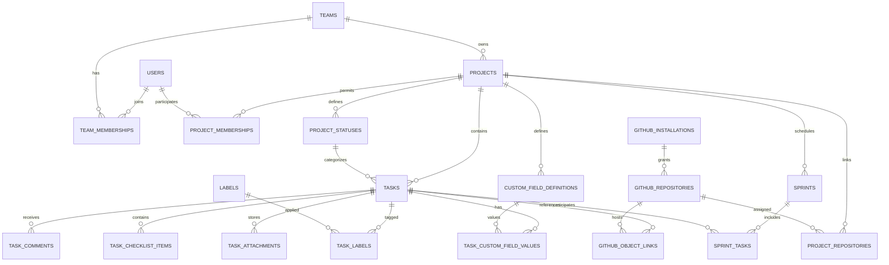

# Database Design Specification (DDS) — AI Agent Ready

> **Product:** Free, open-source project management for small teams (Cloud + Self-Hosted)  
> **Version:** 1.0.0 — FINAL, implementation-ready
> **Status:** FINAL DOCUMENTATION BASELINE — implementation requires explicit user authorization  
> **Language:** English for implementers; product UI must support Arabic RTL and English LTR.  
> **Sources of truth:** `BRD.md` (confirmed business requirements), `ARCHITECTURE.md` (final SAD). Final binding decisions in this document and the final SAD supersede earlier unresolved BRD questions.

## 0. AI agent contract

1. All product choices are finalized. Implement the physical schema and rules in this document without reopening decisions.
2. This document specifies migrations for a future implementation; do not write or run migrations until the user explicitly authorizes implementation. The gates in §15 are engineering acceptance criteria, not outstanding product decisions.
3. Preserve strict team and private-project isolation for queries, search, attachments, comments, notifications, exports, jobs, and integration events.
4. Treat all external IDs, GitHub payloads, invitation tokens, and client-supplied team/project IDs as untrusted.
5. Implement constraints and indexes in PostgreSQL, not just Laravel validation. Where relational checks cross tables, enforce with composite foreign keys, triggers, or transactional service invariants plus tests; note residual risk.
6. Never store GitHub installation access tokens, raw invitation tokens, or plaintext credentials in ordinary tables.
7. Every schema change requires a migration, rollback strategy, test coverage, and BRD traceability.

## 1. Scope, assumptions, conventions

**CONFIRMED:** Users may join multiple teams; roles are Owner, Admin, Member, Viewer. Projects are team-visible or private. The Team Owner can access private projects; Admin does not automatically see private-project content. A unified Task model supports optional sprints, custom statuses/fields/views, comments, and GitHub integration including opt-in bidirectional Issues sync. Cloud and Self-Hosted share the same feature set.

**APPROVED:** PostgreSQL is the production database; Laravel uses one shared schema with team-scoped tenancy. Inertia/Vue are application-layer choices, not database dependencies. `id` uses UUIDv7 as primary key for domain entities; GitHub numeric identifiers use `bigint`; all timestamps use `timestamptz` UTC. Use `snake_case`; singular foreign keys; `created_at`, `updated_at`; `deleted_at` only where explicitly supported. Prefer PostgreSQL `text` with CHECK constraints to hard DB enums when a value may evolve; use `jsonb` only for truly variable, bounded metadata.

**Invariant:** Project belongs to exactly one Team. Task belongs to exactly one Project, and the task's Team must match the project's Team. No cross-team references through assignees, memberships, labels, statuses, sprints, comments, or GitHub mappings.

## 2. Entity relationship overview

Diagram is intentionally conceptual: it omits ancillary tables and authorization predicates. **Do not** infer that a relationship alone grants access.

## 3. Core identity and teams — P0

### `users`

- `id uuid PK`; `name varchar(160) NOT NULL`; `email citext NOT NULL UNIQUE` (or unique index on `lower(email)`); `email_verified_at timestamptz NULL`; `password varchar(255) NOT NULL` (password registration is required; GitHub integration is not social login); `locale varchar(8) NOT NULL DEFAULT 'ar'`; `timezone varchar(64) NOT NULL DEFAULT 'UTC'`; `avatar_path text NULL`; `created_at`, `updated_at`; optional `disabled_at`.
- Enforce normalized emails and supported locale codes (`ar`, `en`). Password hashes only; no password plaintext. Do not use locale as an authorization signal.

### `teams`

- `id uuid PK`; `name varchar(160) NOT NULL`; `slug varchar(100) NOT NULL UNIQUE` (deployment-wide unique); `description varchar(1000) NULL` (CORE-001); `owner_user_id uuid NOT NULL FK users(id)`; `created_at`, `updated_at`; `archived_at NULL` (30-day trash and purge policy).
- Owner must also have exactly one membership with role `owner`. This is a cross-table invariant; enforce ownership transfer in one transaction with row locks, plus integrity verification. Consider a deferrable trigger if required for strict DB-level enforcement.

### `team_memberships`

- `id uuid PK`; `team_id uuid NOT NULL FK teams`; `user_id uuid NOT NULL FK users`; `role varchar(16) NOT NULL CHECK IN ('owner','admin','member','viewer')`; `joined_at timestamptz NOT NULL`; `created_at`, `updated_at`.
- `UNIQUE(team_id,user_id)`; index `(user_id,team_id)`; partial unique index on `team_id WHERE role='owner'` to prevent multiple owners. Owner transfer must atomically update `teams.owner_user_id` and both memberships.

### `team_invitations`

- `id uuid PK`; `team_id uuid NOT NULL FK`; `email citext NULL`; `invited_role varchar(16) NOT NULL CHECK IN ('admin','member','viewer')`; `token_hash bytea NOT NULL UNIQUE`; `invited_by uuid NOT NULL FK users`; `expires_at timestamptz NOT NULL`; `accepted_at`, `revoked_at NULL`; `max_uses int NULL`; `use_count int NOT NULL DEFAULT 0`; `created_at`, `updated_at`.
- **FINAL:** email-bound invitations require matching verified email and have `max_uses=1`; generic share links have `email NULL`, require verified account email, and have `max_uses=20`. Both expire in 7 days, may be revoked, and increment `use_count` atomically. Never log raw tokens.

## 4. Projects, membership and visibility — P0

### `projects`

- `id uuid PK`; `team_id uuid NOT NULL FK teams`; `name varchar(180) NOT NULL`; `project_key varchar(20) NOT NULL`; `description text NULL`; `visibility varchar(16) NOT NULL DEFAULT 'team' CHECK IN ('team','private')`; `created_by uuid NOT NULL FK users`; `sprints_enabled boolean NOT NULL DEFAULT false`; `next_task_number bigint NOT NULL DEFAULT 1 CHECK > 0`; `archived_at NULL`; `created_at`, `updated_at`.
- `UNIQUE(team_id,project_key)` (normalize uppercase at application boundary and enforce canonical format); `UNIQUE(id,team_id)` to support composite FK from descendants; index `(team_id,visibility,archived_at)`.
- Team Owner bypasses private membership **only at authorization layer**, not by synthetic membership records. Admin has no implicit private content access. New projects default to team-visible.

### `project_memberships`

- `id uuid PK`; `project_id uuid NOT NULL`; `team_id uuid NOT NULL`; `user_id uuid NOT NULL`; `project_role varchar(24) NOT NULL CHECK IN ('manager','contributor')`; `added_by uuid NOT NULL`; `created_at`, `updated_at`.
- `UNIQUE(project_id,user_id)`; composite FK `(project_id,team_id) -> projects(id,team_id)` and `(team_id,user_id) -> team_memberships(team_id,user_id)`; indexes `(user_id,project_id)` and `(team_id,project_id)`.
- **DECIDED-003:** Team Owner can access every project. Team Admin without explicit private-project membership cannot discover its existence, name, counts, or content through any UI, API, search, notification, export, attachment, or GitHub metadata. Private project roles are manager and contributor; creator is manager; Team Owner has implicit manager authority. Team Viewer remains read-only even if assigned a project role.
- **Implemented (CORE-003, ADR-020):**
  - **CHECK constraints:** `visibility`, `project_role`, key format `^[A-Z][A-Z0-9]{1,9}$`, non-blank `name`, `next_task_number > 0` and `version > 0`.
  - **Keys and the trash:** `UNIQUE(team_id, project_key)` includes trashed projects, so a key stays reserved during the 30-day recovery window.
  - **Foreign-key actions:**
    - `projects.team_id` and `(project_id, team_id)` cascade. Only the trash purge deletes.
    - `created_by` and `added_by` are `RESTRICT`.
    - `(team_id, user_id) → team_memberships` has no ON DELETE action. Removing a team member deletes their project memberships in the same transaction, and the database refuses a team membership delete that would leave any behind.
    - That key is `DEFERRABLE INITIALLY IMMEDIATE`. The team purge (CORE-010) must `SET CONSTRAINTS project_memberships_team_id_user_id_foreign DEFERRED`, or delete project memberships first, because PostgreSQL checks it during the cascade to `team_memberships`, before the cascade to `projects`.
  - **`AccessibleProjects` (§10.2):** `App\Support\Tenancy\AccessibleProjects` implements the single authorization query; later resources use its `constrain()`.

### `project_templates` and `project_views` — public v1.0

- `project_templates`: `id`, `team_id uuid NOT NULL FK teams`, `owner_user_id uuid NOT NULL FK users`, `name`, `config jsonb`, `version int`, timestamps. **FINAL:** `team_id NOT NULL`, `owner_user_id NOT NULL`, `visibility` is `draft|published`; drafts are visible to author only; published templates to team. Only Owner/Admin can publish. Validate `config` against versioned schema; no executable expressions.
- `project_views`: `id`, `project_id`, `name`, `view_type CHECK IN ('board','list','calendar')`, `filters jsonb`, `sort jsonb`, `visibility`, `created_by`, `position`, timestamps. Restrict filters to an allowlisted query DSL; never interpret SQL from JSON. **FINAL:** `visibility` is `personal|project`; personal views visible to creator and Team Owner, project views to authorized project viewers. Creator edits personal view; Project Manager/Owner edits project view.

## 5. Tasks, workflow, classification — P0

### `project_statuses`

- `id uuid PK`; `project_id uuid NOT NULL`; `team_id uuid NOT NULL`; `name varchar(100) NOT NULL`; `category varchar(16) NOT NULL CHECK IN ('todo','in_progress','done')`; `position numeric(20,10) NOT NULL`; `color varchar(16) NULL`; `is_default boolean NOT NULL DEFAULT false`; `created_at`, `updated_at`.
- Composite FK `(project_id,team_id) -> projects`; `UNIQUE(project_id,id)`; partial unique `(project_id) WHERE is_default`; index `(project_id,position)`; consider unique case-insensitive status names per project. Require at least one status and prevent deleting a status used by tasks unless reassignment is atomic.
- **Implemented (CORE-004, ADR-021):**
  - **Keys:** composite FK `(project_id, team_id) → projects(id, team_id)` with ON DELETE CASCADE, so the purge removes statuses; `UNIQUE(project_id, id)` for the tasks' `(status_id, project_id)` key; partial unique `(project_id) WHERE is_default`; index `(team_id, project_id)`.
  - **Names:** unique per project ignoring case, a functional index on `(project_id, lower(name))` (the "consider" above is adopted); 1–50 characters at the API, column `varchar(100)`.
  - **Order:** `UNIQUE(project_id, position)` replaces the plain `(project_id, position)` index. It is `DEFERRABLE INITIALLY IMMEDIATE`, so it is checked at the end of each statement and a reorder can rewrite every rank in one UPDATE. Ranks are kept dense (`0..n-1`), so the stored rank is also the 0-based ordinal the API returns.
  - **CHECK constraints:** category, a non-blank name, `color` `^#[0-9A-F]{6}$` or NULL, `position >= 0`, `version > 0`.
  - **Workflow rules (transactional, under the project lock):** every project keeps at least one `todo` and one `done` status; at most 50 statuses per project; deleting the default moves the flag to the replacement or the first remaining `todo` status. Moving the tasks of a deleted status to `replacement_status_id` arrives with the `tasks` table (CORE-005), whose `(status_id, project_id)` key must not cascade.
  - **Defaults and upgrade:** every new project gets To do (default), In progress and Done, in the creator's language. The migration seeds the same workflow into existing projects.
  - **Transitions:** none are restricted. Any status of the task's own project is a valid target; the composite key enforces the project match.

### `tasks`

- `id uuid PK`; `team_id uuid NOT NULL`; `project_id uuid NOT NULL`; `task_number bigint NOT NULL CHECK > 0`; `title varchar(200) NOT NULL`; `description text NULL` (sanitize rendered Markdown); `status_id uuid NOT NULL`; `assignee_user_id uuid NULL`; `created_by uuid NOT NULL`; `priority varchar(16) NOT NULL DEFAULT 'none' CHECK IN ('none','low','medium','high','urgent')`; `due_at timestamptz NULL`; `start_at timestamptz NULL`; `position numeric(20,10) NOT NULL`; `parent_task_id uuid NULL`; `created_at`, `updated_at`, `completed_at NULL`; `archived_at NULL`.
- `UNIQUE(project_id,task_number)`; `UNIQUE(id,project_id)`; composite FK `(project_id,team_id) -> projects`; `(status_id,project_id) -> project_statuses(id,project_id)`; `(parent_task_id,project_id) -> tasks(id,project_id)`; assignee `(team_id,assignee_user_id) -> team_memberships(team_id,user_id)` when not null. Indexes `(project_id,status_id,position)`, `(project_id,assignee_user_id)`, `(team_id,project_id,updated_at DESC)`, `(project_id,due_at)`.
- Stable display key = `projects.project_key || '-' || tasks.task_number`; renaming project key would break old links, so **DECIDED:** freeze `project_key` after the first task is created.
- **DECIDED-006:** `assignee_user_id` is the sole nullable primary assignee. Multiple assignees are not supported; watchers are separate entities if implemented.
- Generate `task_number` transactionally: lock `projects` row (`FOR UPDATE`), consume/increment `next_task_number`, insert task in same transaction. Never use `MAX(task_number)+1`.
- **Implemented (CORE-004, ADR-021 §5):**
  - **Allocator:** `App\Domain\Projects\TaskNumbers::allocate()` runs `UPDATE projects SET next_task_number = next_task_number + 1 … RETURNING`. It is called after `ProjectWriteLock::project()` (team row, then the project row `FOR NO KEY UPDATE`, which serialises allocators just as well) and refuses to run outside a transaction.
  - **Key freeze:** "after the first task" means `next_task_number > 1`, so a number has been issued. Deleting tasks does not unfreeze the key. The API answers a frozen key change with 409.
  - **Trigger:** `projects_guard_task_numbering` refuses, on every path, a `project_key` change once `next_task_number > 1` and any decrease of `next_task_number`.
- Parent tasks cannot point to themselves or form cycles; use a service-level recursive validation with concurrency tests (or trigger). **FINAL:** maximum nested depth is 3 below the root task; reject cycles transactionally.

### `labels` and `task_labels`

- `labels`: `id`, `team_id`, `project_id`, `name`, `color`, timestamps; `UNIQUE(project_id,lower(name))` via functional unique index; `UNIQUE(id,project_id)`.
- `task_labels`: `task_id`, `project_id`, `label_id`, `created_at`; PK `(task_id,label_id)`; composite FK `(task_id,project_id) -> tasks(id,project_id)` and `(label_id,project_id) -> labels(id,project_id)`.

### `task_checklist_items`

- `id`, `task_id`, `content varchar(300)`, `is_done boolean`, `position numeric(20,10)`, `completed_by NULL`, `completed_at NULL`, timestamps. Index `(task_id,position)`.

### `task_comments`

- `id`, `task_id`, `author_user_id`, `body text`, `edited_at NULL`, `deleted_at NULL`, timestamps. Index `(task_id,created_at)`; soft-deletion follows the 30-day recovery policy in §18. Permission-check authorship and current project visibility before serving.

### `task_activities`

- `id`, `team_id`, `project_id`, `task_id`, `actor_user_id NULL`, `action varchar(80)`, `changes jsonb`, `source varchar(20)`, `created_at`; index `(task_id,created_at DESC)` and `(team_id,created_at DESC)`.
- Store a bounded, sanitized allowlist of changes. Do not store passwords, access tokens, invitation tokens, private webhook payloads, or unnecessary personal information.

### `task_attachments`

- `id`, `team_id`, `project_id`, `task_id`, `uploaded_by`, `storage_disk varchar(50)`, `storage_key text`, `original_name text`, `mime_type varchar(255)`, `size_bytes bigint CHECK >= 0`, `sha256 bytea NULL`, `created_at`, `deleted_at NULL`.
- Storage keys are opaque; downloads require fresh authorization and short-lived signed access (or proxied stream). No public buckets by default. **DECIDED-004** controls size/quota/retention limits.

## 6. Custom fields — public v1.0

### `custom_field_definitions`

- `id`, `team_id`, `project_id`, `key varchar(80)`, `name varchar(120)`, `field_type varchar(24) CHECK IN ('text','number','date','boolean','single_select','multi_select','url')`, `is_required boolean`, `config jsonb`, `position`, `archived_at NULL`, timestamps; `UNIQUE(project_id,key)`; `UNIQUE(id,project_id)`.
- Define field config schemas and bounds by type. Archiving a definition preserves historical values; changing type requires explicit migration/validation.

### `custom_field_options`

- `id`, `field_id`, `value varchar(200)`, `label varchar(200)`, `position`, `archived_at NULL`; `UNIQUE(field_id,value)`.

### `task_custom_field_values`

- `task_id`, `project_id`, `field_id`, `value_json jsonb NOT NULL`, `updated_by`, `updated_at`; PK `(task_id,field_id)`; composite FK `(task_id,project_id) -> tasks(id,project_id)` and `(field_id,project_id) -> custom_field_definitions(id,project_id)`.
- `url` values are HTTPS or HTTP URLs, max 2048 characters, serialized as a JSON string; reject javascript:, data:, credentials in URL, and malformed hosts. `value_json` must match field type and option set at write time. For frequently filtered fields, add selective expression indexes or migrate to typed value columns after measuring workloads; do not create a broad unbounded GIN index by default.

## 7. Optional sprints — public v1.0

### `sprints`

- `id`, `team_id`, `project_id`, `name`, `goal text NULL`, `state varchar(16) CHECK IN ('planned','active','completed')`, `starts_at timestamptz NULL`, `ends_at timestamptz NULL`, `completed_at NULL`, timestamps; composite FK to project; index `(project_id,state,starts_at)`.
- **FINAL:** disabling sprints is rejected while one is active; planned/completed history remains stored and read-only while disabled. Re-enable restores access; only one active sprint per project.

### `sprint_tasks`

- `sprint_id`, `project_id`, `task_id`, `added_at`, `removed_at NULL`, `completed_in_sprint boolean NULL`; composite FKs to `sprints` and `tasks` by `(id,project_id)`; index `(task_id,added_at DESC)`.
- This is **history-aware membership**. **FINAL:** partial unique `(task_id) WHERE removed_at IS NULL` enforces at most one current sprint per task. On close, mark all memberships removed, retain history, and return incomplete tasks to backlog unchanged. Partial unique `(project_id) WHERE state='active'` enforces one active sprint. Story Points are optional integer 1–100 on `tasks.story_points`.

## 8. Notifications and user preferences — P0/P1

### `notifications`

- `id`, `recipient_user_id`, `team_id NULL`, `project_id NULL`, `actor_user_id NULL`, `type varchar(80)`, `payload jsonb`, `read_at NULL`, `created_at`; index `(recipient_user_id,read_at,created_at DESC)`.
- Notification rendering must recheck authorization at read time. For a revoked private-project member, suppress or redact project data. Payload must not cache secrets or unrestricted private content.

### `user_preferences`

- `user_id PK`, `email_notifications boolean`, `in_app_notifications boolean`, `theme varchar(16)`, `settings jsonb`, `updated_at`. Validate bounded JSON keys; keep locale/timezone on `users`.

## 9. GitHub integration — v1.0 linkage / v1.1 Issues sync (security-critical)

### `github_installations`

- `id uuid PK`, `github_installation_id bigint NOT NULL UNIQUE`, `account_node_id text NULL`, `account_login text`, `installation_status varchar(24)`, `permissions_snapshot jsonb`, `installed_at`, `revoked_at NULL`, timestamps.
- GitHub App identity/configuration is deployment-scoped. **Important:** an installation can be authorized for one or more teams only through explicit binding, not inferred from a GitHub account name.

### `team_github_installations`

- `team_id`, `installation_id`, `connected_by`, `created_at`; PK `(team_id,installation_id)`; only explicitly authorized team admins/owners may bind/unbind. Cross-team reuse requires deliberate policy.

### `github_repositories`

- `id uuid PK`, `installation_id`, `github_repository_id bigint NOT NULL`, `node_id text NULL`, `full_name text`, `is_private boolean`, `is_accessible boolean`, `last_seen_at`, timestamps; `UNIQUE(installation_id,github_repository_id)`; `UNIQUE(id,installation_id)`.
- Repository rename must not break identity: use immutable GitHub repository ID. Do not expose private repo metadata solely because a user belongs to the team.

### `project_repositories`

- `id`, `team_id`, `project_id`, `repository_id`, `installation_id`, `linked_by`, `link_status`, `created_at`; `UNIQUE(project_id,repository_id)`; composite FK project/team and repository/installation; validate installation is bound to the same team. **DECIDED-008:** member-level repository visibility policy.

### `github_object_links`

- `id`, `team_id`, `project_id`, `task_id`, `repository_id`, `object_type varchar(20) CHECK IN ('issue','pull_request','branch','commit')`, `github_node_id text NULL`, `github_number bigint NULL`, `github_sha varchar(64) NULL`, `github_ref text NULL`, `url text`, `state varchar(32) NULL`, `metadata jsonb`, `last_seen_at`, timestamps.
- Composite FKs ensure linked task/project match; uniqueness by repo/type/stable remote ID, with separate partial unique indexes for number, SHA, or ref where appropriate. Branches can be renamed; PRs are not Issues even when provider endpoints overlap.

### `github_issue_mappings`

- `id`, `team_id`, `project_id`, `task_id`, `repository_id`, `github_issue_number bigint`, `github_issue_node_id text`, `sync_enabled boolean DEFAULT false`, `field_ownership jsonb`, `local_version bigint`, `remote_updated_at NULL`, `last_synced_at NULL`, `sync_status varchar(24)`, timestamps.
- `UNIQUE(repository_id,github_issue_number)` and `UNIQUE(task_id,repository_id)` **APPROVED**; mappings must not silently cross projects/teams. **DECIDED-005:** one issue per task per repository; field ownership/conflict and close/delete behavior are defined in §18. A unique repository issue mapping prevents accidental duplicate import.

### `github_webhook_deliveries`

- `id`, `github_delivery_id uuid UNIQUE`, `installation_id NULL`, `event_name varchar(100)`, `action varchar(100) NULL`, `signature_verified boolean NOT NULL`, `payload_digest bytea`, `received_at`, `processed_at NULL`, `status varchar(24)`, `attempt_count int DEFAULT 0`, `last_error_code varchar(80) NULL`.
- Verify HMAC **before** trusting payload and before enqueueing processing; store only minimal sanitized metadata by default. Delivery ID uniqueness makes redelivery idempotent. Do not depend on delivery order.

### `github_sync_outbox` and `github_sync_conflicts`

- `github_sync_outbox`: `id`, `team_id`, `project_id`, `mapping_id`, `event_type`, `payload jsonb`, `idempotency_key text UNIQUE`, `available_at`, `attempts`, `processed_at NULL`, `last_error_code NULL`, timestamps. Enqueue inside same transaction as local change.
- `github_sync_conflicts`: `id`, `mapping_id`, `field_name`, `local_snapshot jsonb`, `remote_snapshot jsonb`, `resolution varchar(24) NULL`, `resolved_by NULL`, `resolved_at NULL`, `created_at`.
- Encrypt or omit sensitive fields, redact logs, retry transient failures with backoff, respect GitHub rate limits. No remote writes without opt-in policy and verified installation scope.

### `automation_rules` and `automation_runs`

- `automation_rules`: `id`, `team_id`, `project_id`, `name`, `enabled`, `trigger_type`, `conditions jsonb`, `actions jsonb`, `created_by`, timestamps. Only allowlisted declarative operations; never execute user-supplied PHP/SQL/JS.
- `automation_runs`: `id`, `rule_id`, `event_key`, `status`, `executed_at`, `error_code NULL`; `UNIQUE(rule_id,event_key)` for idempotency. Check project visibility and workflow validity before moving tasks.

## 10. Security and tenant isolation design

1. Every team-owned root row has `team_id`. Descendants carry `team_id`/`project_id` where useful for scoping and composite referential integrity. Avoid relying on a single unscoped `find($id)` followed by late policy checks.
2. Define a single `AccessibleProjects` authorization query/service: team Owner sees all; other roles see team-visible projects plus private projects with explicit membership. Read/list/search/count/export endpoints and background jobs must use equivalent authorization rules.
3. Use PostgreSQL composite FKs to reject cross-project references where practical. For `tasks.status_id`, ensure status belongs to same project; for assignees, ensure user belongs to team; for private members, ensure team membership.
4. Attachment authorization must be checked on each request. Storage bucket visibility must never be treated as project authorization.
5. On membership revocation, invalidate active access as promptly as possible; revalidate authorization when generating notifications, exports, or downloads. Recheck GitHub installation permissions and project mapping before outbound writes.
6. RLS is optional defense-in-depth. If adopted, specify transaction-local session context and pooled-connection reset behavior; never rely solely on RLS or only on client-supplied tenant headers.
7. Admin may manage team settings but **does not implicitly see private-project content**. Team Admin cannot see private-project metadata without explicit membership (DECIDED-003).

## 11. Transaction boundaries and concurrency

- **Team ownership transfer:** lock team and both memberships; ensure exactly one owner, update atomically, audit event.
- **Task creation:** lock project counter, allocate immutable task number, validate status/assignee/team, insert task and activity atomically.
- **Move task:** validate actor and destination status belong to same project, update ordering atomically; reindex sparse positions when necessary.
- **Change project visibility:** audit change; if switching to private, re-evaluate membership, search cache, notifications, and external link previews before exposing data.
- **Invite acceptance:** compare token hash; lock invitation; check expiry, revocation, email/verification policy and max uses; upsert membership idempotently.
- **GitHub sync:** commit local change and outbox atomically; process outbox at least once with idempotency; store checkpoint and conflict state; never assume exactly-once delivery.
- **Sprint close:** lock sprint, snapshot outcomes, close active memberships, and return unfinished tasks to backlog without changing their status.

## 12. Index, search and performance plan

- Add indexes based on tenant-scoped access paths, not just individual foreign keys. Candidate high-volume indexes: `tasks(project_id,status_id,position)`, `tasks(project_id,assignee_user_id,updated_at DESC)`, `task_comments(task_id,created_at DESC)`, `notifications(recipient_user_id,read_at,created_at DESC)`, `task_activities(task_id,created_at DESC)`, `github_webhook_deliveries(github_delivery_id)` unique.
- Use `pg_trgm`/full-text search only after access-scoped query design. Search results must apply authorization **before** returning hits, counts, or snippets. Arabic search quality requires explicit testing and may need an alternative search service later; do not claim PostgreSQL's default English text search handles Arabic well.
- Use cursor/keyset pagination for large feeds, bounded filters, eager-loading to avoid N+1 queries, and selective materialized counters only if proven necessary.
- Index maintenance, `EXPLAIN (ANALYZE, BUFFERS)` for representative data, and migration lock duration must be part of performance QA.

## 13. Retention, deletion, backup and portability

- **DECIDED-011 (closed; see §18):** archive is reversible and read-only; delete moves a team/project to trash for 30 days, after which a scheduled job purges app data. Hard deletion removes application data and queued integration links, backups age out per retention, and remote GitHub resources are never deleted. Implement purge only through the 30-day trash lifecycle, never as an immediate cascade.
- **DECIDED-004:** Cloud storage quotas, attachment retention, export, and backup policies. Cloud fair-use limits must not become paywalled feature gates; Self-Hosted operator controls storage infrastructure.
- Keep transactional database backups consistent with attachment snapshots. Document point-in-time recovery if supported and test restores. Encrypt backups and limit access.
- Provide a versioned export format for team/project data; importing must regenerate or remap internal IDs safely and preserve privacy rules. Export includes teams, memberships, projects, workflows, tasks, comments, checklist items, labels, custom fields, views, sprint history and audit metadata, plus attachment manifests and signed downloadable attachment archive. Exclude secrets, password hashes, private tokens and GitHub installation credentials. Import is outside public v1.0; exports use versioned JSON manifests.

## 14. Migration implementation sequence

| Order | Migration group | Dependencies | Release |
|---|---|---|---|
| 01 | Users, teams, team_memberships, invitations | Auth and ownership rules | P0 |
| 02 | Projects, project_memberships | Privacy/DECIDED-003 | P0 |
| 03 | Project statuses, tasks, labels, checklist | DECIDED-006, stable task key policy | P0 |
| 04 | Comments, attachments, activities, notifications | Storage/retention decisions | P0 |
| 05 | Custom fields, project views, templates | DECIDED-009 | P1 |
| 06 | Sprints and sprint task history | Sprint carryover rules | P1 |
| 07 | GitHub installations, repos, links, delivery inbox | DECIDED-008 | P1 |
| 08 | Issue mappings, outbox, conflicts, automation | DECIDED-005 | P1 |

**Migration rules:** use PostgreSQL in CI; apply migrations to an empty DB and a realistic prior-version DB; prefer expand → backfill → contract for breaking changes; never ship destructive migrations without backups and rollback plan; seed only demo data in explicit development environments.

## 15. Closed Decision Gates

All previous decision gates are closed; binding choices are listed in §18.

## 16. Verification matrix — minimum acceptance tests

| Test ID | Scenario | Expected |
|---|---|---|
| DB-T01 | User in Team A guesses Team B project/task ID | No content, count, search hit, attachment, or metadata leak |
| DB-T02 | Team Admin without private-project membership | No private content; Owner retains access |
| DB-T03 | Assign task to non-member of task's team | Rejected; DB invariant holds |
| DB-T04 | Assign status/label/custom field from another project | Rejected; no partial write |
| DB-T05 | Two simultaneous task creates | Distinct, monotonic project task numbers |
| DB-T06 | Concurrent owner transfers | Exactly one owner and matching owner membership |
| DB-T07 | Invitation replay, expiry, revocation | Rejected or idempotent per approved policy |
| DB-T08 | Member removed from private project | No access to old comments, files, search or notifications |
| DB-T09 | Duplicate/reordered GitHub webhook | Idempotent processing; no duplicate task or loop |
| DB-T10 | Revoked GitHub installation | No unauthorized outbound writes; local tasks remain usable |
| DB-T11 | Simultaneous local and remote Issue edits | Explicit deterministic conflict handling; no silent data loss |
| DB-T12 | Restore DB plus attachment storage | Referential integrity and authorized downloads verified |
| DB-T13 | Arabic and English titles, search and sorting | Unicode retained; RTL is UI concern; no text corruption |
| DB-T14 | Private repo linked to team-visible project | Repo metadata not leaked without approved access policy |

## 17. AI agent handoff

**Business Analyst:** keep BRD, `TRACEABILITY.csv` and this document aligned with the §18 decision register; no product-owner gates remain open.  
**Database Engineer:** convert approved entities into ordered Laravel migrations, explicit composite constraints, indexes, and schema diagram; flag PostgreSQL-specific features.  
**Backend Engineer:** implement transaction boundaries and policy-scoped repositories/services; avoid controller-level tenant filtering as sole defense.  
**Frontend Engineer:** treat database field names as implementation detail; consume validated DTO/API contracts.  
**QA/Security Engineer:** implement §16 negative tests, concurrency tests, GitHub webhook replay and private-project leakage cases.  
**DevOps Engineer:** validate Docker PostgreSQL persistence, migrations, backups, restore and version upgrades in Cloud and Self-Hosted.

### Definition of Database Ready

- All schema-affecting product decisions are closed and binding.
- Entity tables, keys, composite foreign keys, deletion behaviors, indexes and migration order are approved.
- Cross-tenant/private-project negative tests are defined and pass against PostgreSQL.
- Backup/restore and upgrade plans are documented and rehearsed.
- Traceability from BRD → architecture → schema → tests is maintained.

## 18. Final Binding Decision Register

This section is normative and supersedes earlier provisional statements, questions, and unresolved BRD items. No additional product-owner decisions are required for the topics below.

- **DECIDED-001:** Product name is سنع (SN3); public domain and logo are deployment configuration, not schema or launch blockers.
- **DECIDED-002:** License is AGPL-3.0-only; dependencies must be license-compatible; publish source and modifications as required by license.
- **DECIDED-003:** Team Owner can access every project. Team Admin without explicit private-project membership cannot discover its existence, name, counts, or content through any UI, API, search, notification, export, attachment, or GitHub metadata. Private project roles are manager and contributor; creator is manager; Team Owner has implicit manager authority. Team Viewer remains read-only even if assigned a project role.
- **DECIDED-004:** Cloud: 25 MB per attachment, 2 GB attachment storage per team, 120 requests/minute per authenticated user with burst control; unlimited projects/tasks/members; 30-day soft-delete recovery; daily encrypted backups retained 14 days; operational logs 30 days. Self-host limits configurable; user exports available.
- **DECIDED-005:** One GitHub Issue maps to at most one local task and each task to at most one Issue per linked repository; local task is canonical for title/body/labels/assignee/status when mapped, GitHub edits are imported only when no pending local change; conflicts keep local value and create a visible conflict event; GitHub closed/reopened maps to Done/previous nonterminal status; never propagate hard deletion; explicit unlink does not delete either side.
- **DECIDED-006:** Exactly one primary assignee per task (nullable); collaborators/watchers are separate and not assignees.
- **DECIDED-007:** Invitations may be email-address-specific or shareable team links; email invitations require verified matching email; share links require verified account email, expire after 7 days, can be revoked, and are reusable up to 20 redemptions; role on invite cannot exceed Member, except email-specific Admin invites created by Owner.
- **DECIDED-008:** Repository metadata and linked objects are shown only to authorized project viewers; private repo content is never mirrored in full; repo operations use the GitHub App installation token and authorization against linked project, not each user's GitHub permissions; avoid exposing private repository names outside project.
- **DECIDED-009:** Only **published** team templates are readable by authorized team members. **Draft** templates are visible only to their author, including when the author is a Member; Team Owner/Admin cannot read a different author’s draft merely by holding a team role. Owner/Admin can publish their own drafts; publishing another member’s draft requires that member to explicitly share or submit it for publication through an authorized workflow. Published templates can be edited by Owner/Admin; other members can create and edit their own drafts.
- **DECIDED-010:** Laravel 12.x, PHP 8.3+, Vue 3.x, TypeScript 5.x, Inertia 2.x, PostgreSQL 16+, Node.js 22 LTS; pin exact tested patch versions in lockfiles at implementation; Linux amd64/arm64 Docker Compose is the supported production target.
- **DECIDED-011:** Archive is reversible and read-only; delete moves team/project to trash for 30 days then purges by scheduled job; Owner alone deletes team, Owner or project manager deletes project; hard deletion removes app data and queued integration links, with backups aging out per retention; exports before deletion; no automatic remote GitHub deletion.
- **DECIDED-012:** GitHub App repository linking, PR/commit/branch associations and basic automation are required for public v1.0; two-way Issues synchronization is required for v1.1; neither is a paid feature.

**Implementation rule:** Treat these as fixed requirements. Cloud and Self-Hosted have feature parity; operational resource limits are configurable. Lock exact tested dependency patch versions during project initialization.

## 19. Final schema/permission invariants (normative)

- `project_memberships.project_role` is required and constrained to `manager|contributor`; no Project Viewer role exists. Team Viewer is always read-only. For team-visible projects, Owner/Admin can manage and Member can edit tasks; Project Manager additionally manages project settings/membership, but cannot override team-level limits. For private projects, non-Owner access requires an explicit project membership; manager manages project settings/members, contributor edits tasks, and Team Viewer only reads.
- All foreign keys from project child objects must constrain the project/team relationship; membership removal transactionally revokes project access and cancels actor-initiated privileged jobs.
- Task `assignee_user_id` is a single nullable foreign key to an eligible team member with project write access; no multi-assignee join table.
- `project_key` is immutable after first task. Subtasks allow up to three descendant levels below root (root depth 0, deepest depth 3); reject cycles and cross-project parents transactionally.
- Saved views: `private` (creator only), `project` (all authorized project readers); only manager or Team Owner may publish project-wide views.
- Sprint rule: at most one active sprint per project, enforced transactionally; a task may belong to at most one non-completed sprint; closing sprint leaves incomplete tasks in backlog unless explicitly moved to next planned sprint.
- Custom field types: `text`, `number`, `date`, `boolean`, `single_select`, `multi_select`, `url`; validate type and allowed options server-side; definitions belong to one project.
- GitHub mapping uniqueness: `(repository_id, issue_number)` and `(repository_id, task_id)` unique; task can map once per repository; webhook delivery unique by GitHub delivery ID and installation; conflicts persist without exposing raw private payloads.
- Archive makes object read-only and reversible. Delete moves to trash for 30 days, then purges app data; GitHub remote content is never deleted.

## 19.1 Task dependency contract (public v1.0)
`task_dependencies`: `id uuid PK`, `project_id uuid NOT NULL`, `blocker_task_id uuid NOT NULL`, `blocked_task_id uuid NOT NULL`, `created_by uuid NOT NULL`, `created_at timestamptz NOT NULL`; unique `(blocker_task_id, blocked_task_id)`; CHECK blocker != blocked; composite FKs `(blocker_task_id,project_id)` and `(blocked_task_id,project_id)` to `tasks(id,project_id)`. Enforce acyclic directed graph transactionally, with concurrent-insert tests. `blocks` is the only relationship type in v1.0; dependencies do not automatically transition statuses.

## 20. Final API-to-schema closure (normative)
- Add `version bigint NOT NULL DEFAULT 1` to `projects`, `tasks`, `sprints`, `project_statuses`, and `github_issue_mappings`; successful updates increment it atomically. `If-Match` checks this field.
- Add `tasks.story_points smallint NULL CHECK (story_points BETWEEN 1 AND 100)`.
- Add `deleted_at timestamptz NULL` to `teams` and `projects`; `archived_at` is independent read-only archive state. Purge deleted rows after 30 days.
- Add `api_idempotency_records` (`id uuid PK`, `actor_user_id`, `team_id NULL`, `route_key`, `idempotency_key uuid`, `request_digest`, `response_status`, `response_json jsonb`, `expires_at`, timestamps), unique `(actor_user_id,route_key,idempotency_key)`; retain 24 hours.
- Add `team_exports` (`id uuid PK`, `team_id`, `requested_by`, `status`, `storage_key`, `expires_at`, timestamps) for async exports.
- Use PostgreSQL `citext` extension for case-insensitive email columns (no alternative schema branch).
- `project_templates.visibility`: `draft|published`; `project_views.visibility`: `personal|project`; enforce scoping and authorization.
- `team_invitations`: `email NULL` denotes share link (20 uses); non-null email denotes bound invite (one use). Both expire after 7 days.
- Ensure all mandatory composite FKs, partial indexes and version fields are present in migration tests.
